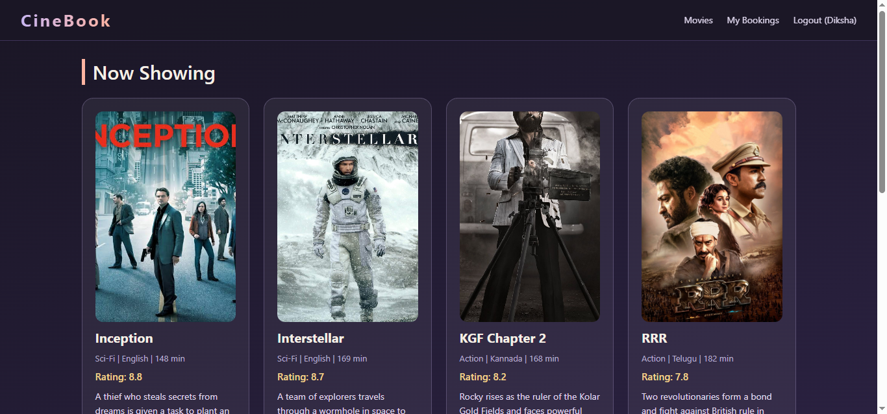
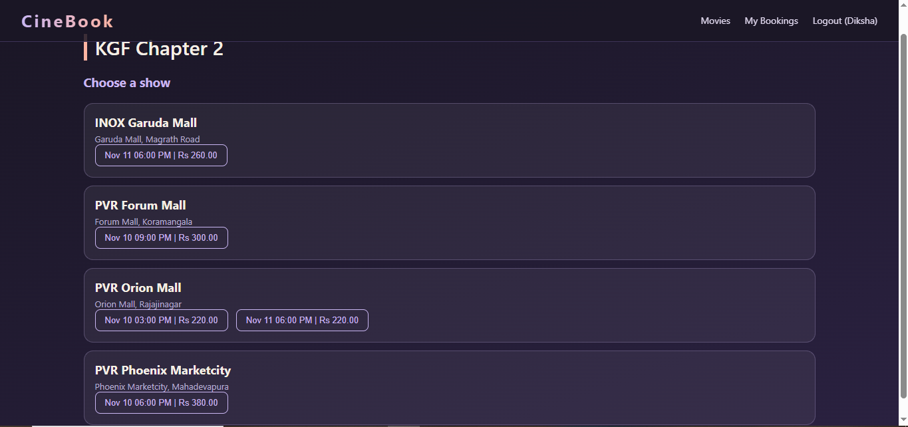
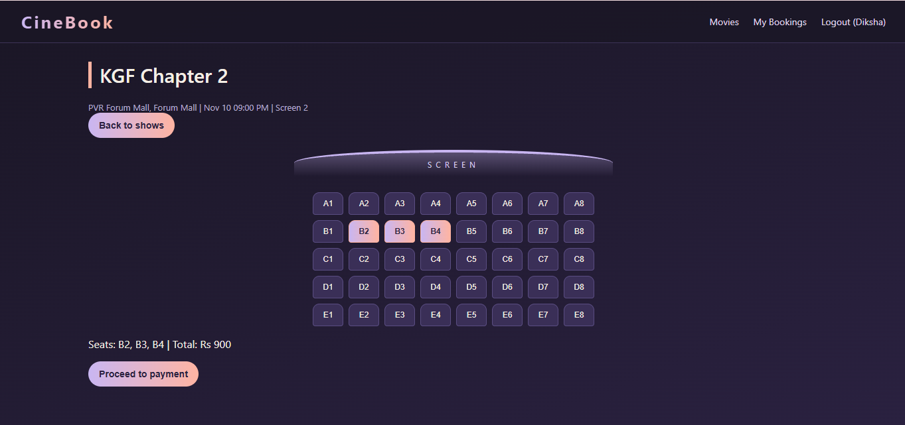
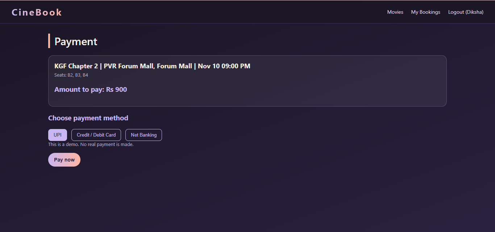
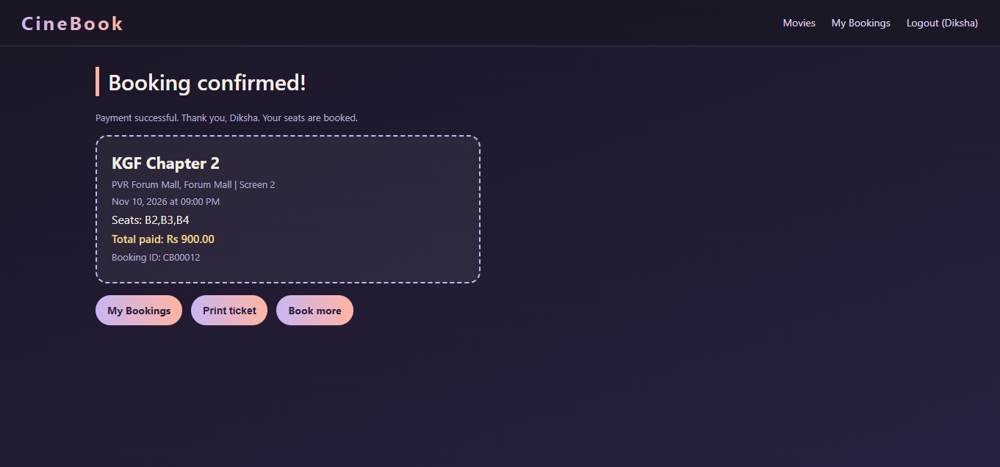

# CineBook - Movie Ticket Booking System

A full-stack movie ticket booking website for Bengaluru theatres. Users can sign up, browse movies, choose a show at a mall theatre, pick seats, pay (simulated), get a ticket, and receive a confirmation email.
## Demo Video

[Watch the demo video](https://drive.google.com/file/d/1UldaEz6X04-6jDd7qJbGznqKhzy9243a/view?usp=sharing)

## Screenshots

## Features

- User sign up and login with JWT authentication and hashed passwords (bcryptjs)
- Browse 8 movies with posters, ratings and descriptions
- Showtimes grouped by theatre (PVR, INOX, Cinepolis in Bengaluru malls)
- Interactive seat map (5 rows x 8 seats) with booked seats shown
- Double booking prevention using a database transaction and a unique key on (show, seat)
- Simulated payment page (UPI, Card, Net Banking) - no real payment is made
- Booking confirmation ticket with booking ID
- My Bookings page with cancellation (seats are released again)
- Confirmation email sent after booking (Nodemailer)

## Tech Stack

- Frontend: HTML, CSS, JavaScript
- Backend: Node.js, Express
- Database: MySQL
- Auth: JWT, bcryptjs
- Email: Nodemailer (Gmail)

## How double booking is prevented

The booked_seats table has a unique key on (show_id, seat_number). A booking is saved inside a transaction, so if any chosen seat is already taken, the database rejects it and the whole booking is rolled back. Two users cannot get the same seat, even if they click at the same moment.

## Run it locally

1. Clone the repository and run:

    npm install

2. Create a MySQL database named movie_booking and create the tables (see database/schema.sql).

3. Create a .env file in the main folder:

    PORT=3000
    DB_HOST=localhost
    DB_USER=root
    DB_PASSWORD=your_mysql_password
    DB_NAME=movie_booking
    JWT_SECRET=any_long_random_text
    MAIL_USER=your_sending_gmail@gmail.com
    MAIL_PASS=your_gmail_app_password

4. Start the server and open http://localhost:3000

    node server.js

## Notes

- Payment is a demo flow only. No real money or card details are used.
- Movie posters are used for demonstration purposes only.
- Showtimes and prices are sample data.

## Future improvements

- Email verification at sign up
- Real payment gateway in test mode
- Admin page to add movies and shows